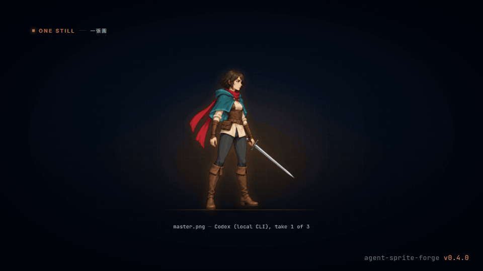
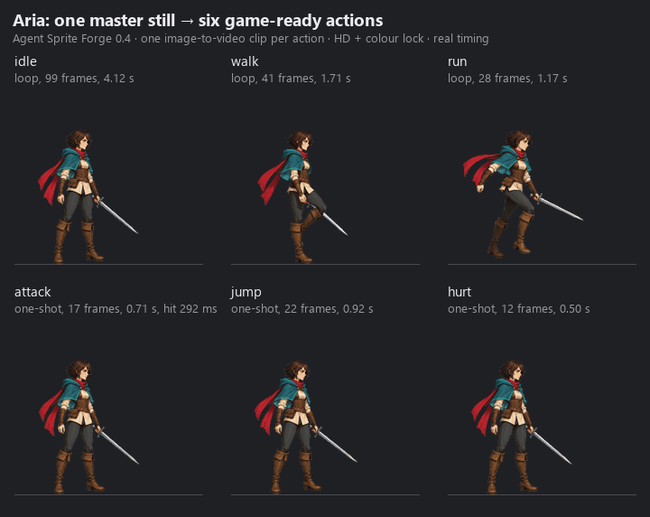
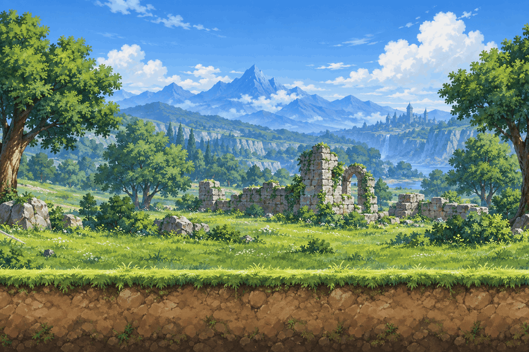
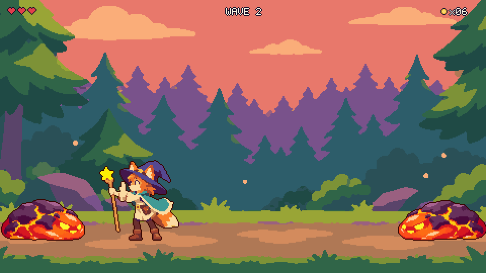
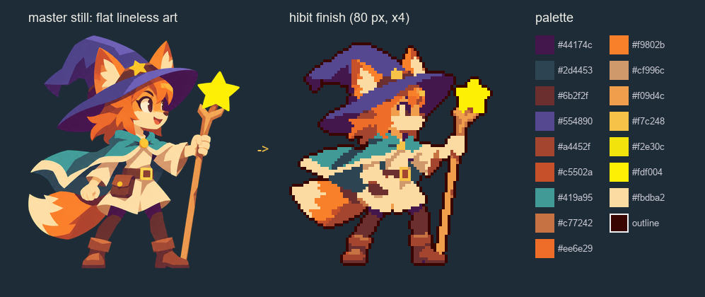
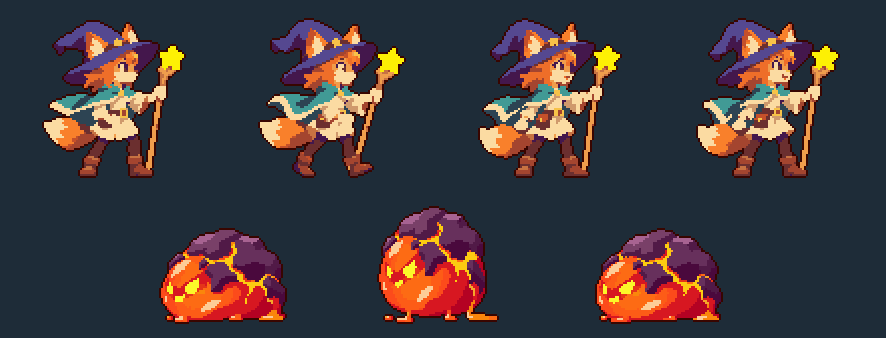
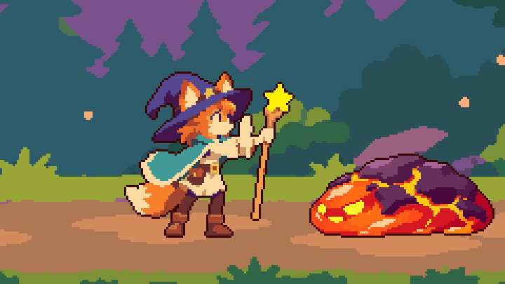
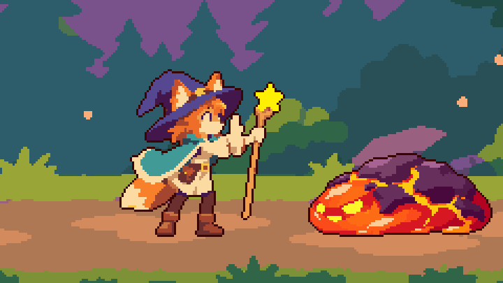

# Agent Sprite Forge

言語：[English](./README.md) | [繁體中文](./README.zh-TW.md) | [简体中文](./README.zh-CN.md) | [日本語](./README.ja.md) | [한국어](./README.ko.md)

<p align="center">
  
</p>

<p align="center">
  <a href="https://trendshift.io/repositories/42911?utm_source=repository-badge&amp;utm_medium=badge&amp;utm_campaign=badge-repository-42911" target="_blank" rel="noopener noreferrer"></a>
</p>

<p align="center">
  
  <br />
  <em>0.4 ティザー：すべてのフレームが ASF の実際の出力です。</em>
</p>

> このページは英語版と同期した要約です。詳しい説明は [English README](./README.md) が正です（繁體中文は全訳）。

## 一枚の原画 → ゲームで使えるスプライト一式

**Claude Code**（プラグイン）、**Codex**、**Grok** 向けのエージェント skills です。エージェントが手元で最良の画像生成経路で原画（master still）を一枚作り、その原画からアクションごとに一本の image-to-video 動画を生成します。決定的な Python ツールが各アクションを検査、キー抜き、位置合わせ、ループ選択、リタイム、仕上げ（finish）、パッケージ化し、Godot、Aseprite、Web ゲームに渡します。

<p align="center">
  
  <br />
  
  <br />
  <em>原画一枚（ローカル Codex CLI で生成）→ アクションごとに Grok の image-to-video → 6 アクション。すべてのフレームは 2026-10-06 の実機実行の出力です。</em>
</p>

## 新機能：hibit、フラットな AI 画を本物のピクセルアートに

<p align="center">
  
  <br />
  <em>Pip's Star Grove：hibit の出力だけで作った 1 画面のデモ。オートパイロットの実機プレイ（ネイティブ 480x270、2 倍表示）。エフェクト：Patch による <a href="https://github.com/patch-gg/pixelfx">pixelfx</a>（MIT）。</em>
</p>

画像モデルに「ピクセルアート」を描かせないでください。**hibit** スタイルはモデルにフラットな線なしの絵を描かせ、ピクセルは後処理で作ります。キャラクターごとに元画素から学習した 1 つのパレット、8x8 の多数決縮小（混色しない）、ちらつきを抑えるヒステリシス、目のハイライトを残す掃除、二値アルファ、そしてキャラクター自身の色から取る 1 px のアウトライン（`--outline auto`、固定のオレンジは使いません）。

<p align="center">
  
  
</p>

- **`master_still.py --finish hibit`**：フラットな線なしの原画。**`finish_frames.py hibit`** / **`sprite_set.py plan --finish hibit`**：パレット、多数決縮小、ヒステリシス、アウトライン（80 px、12 fps）。**`hibit_plate.py`**：480x270 の背景、14 色、シェードマップ付き。
- **エフェクトは 2 ルート**（`fx_pixelfx.py check` が選択、指定があればそれが優先）：**A：Patch による [pixelfx](https://github.com/patch-gg/pixelfx) を推奨**（独立した MIT プロジェクト。各自 `git clone`、Node 18+ が必要。エフェクトごとに 16-91 フレーム、無料、`render` は `CREDITS.txt` を同梱）。**B：画像生成ルート**（2x2 のエフェクトシート → `process --scale-strategy registered` → `hibit_fx.py pixelize`、エフェクトごとに 4 フレーム、ゲームと同じ画風と配色）。

<p align="center">
  
  
  <br />
  <em>左：A（pixelfx）、右：B（画像生成）。50 秒のフルプレイ：<a href="./src/hibit/pip-star-grove-pixelfx.mp4">pixelfx 版 MP4</a> · <a href="./src/hibit/pip-star-grove-imagegen.mp4">画像生成版 MP4</a>。詳細は <a href="./README.md#new-hibit-real-pixel-art-from-flat-ai-art">English README</a>。</em>
</p>

## 0.4 の新機能：大型アップグレード

| 実機での計測 | 以前 | 0.4 |
|---|---:|---:|
| ピクセルの狐（48x64、8 フレーム）：フレームあたりの色数 | 594–709 | **16–19** |
| ピクセルの狐：アルファ段階 / フレームあたりの孤立ピクセル（平均） | 199 / 732 | **2 / 75** |
| キー抜き：紫フリンジ（外周の色漏れ、平均） | 0.704 | **0** |
| キー抜き：145 フレームで漏れたキー画素 / 処理時間 | 7,780 / 271 秒 | **0 / 44 秒** |
| 攻撃：ワンショットの長さ | 4.1 秒 | **0.7 秒** |
| カラーロック：隣接フレーム間の色相反転（走りループ） | 352 | **170** |
| QC：誤って却下された良いテイク | 24 本中 18 本 | **24 本中 0 本** |

- **画像生成が最優先：** すべての画像と動画は `route_media.py` を通ります。設定済みの API キー（OpenAI、Google Gemini、xAI、BytePlus、fal.ai）→ サインイン済みのローカル Codex / Grok CLI → 最後の手段としてコードアート（codeart2d）。
- **原画一枚：** `master_still.py` が候補を生成し、編集で直し、`master.json` として承認します。
- **アクション一式：** `sprite_set.py` がアクションごとに動画を生成し、自動 QC とリテイク、ソフトマット（紫フリンジなし）、位置合わせ、ループの自動選択、ワンショットの自動リタイム、HD カラーロック、既定の HD 仕上げ（依頼があればくっきりしたピクセル仕上げ）、エンジン書き出しまで行います。
- **エンジン書き出し：** animation.json 3.0、PNG アトラス、WebM alpha、packed MP4、Godot SpriteFrames / Sprite3D、Aseprite JSON。マップは Tiled、Godot、LDtk。

ビフォー・アフターの画像と詳細：[What's new](./README.md#whats-new-in-04--the-big-upgrade)、[CHANGELOG](./CHANGELOG.md)、[実機記録](./docs/validation-2026-10-06.md)。

## クイックスタート

1. **インストール。** Claude Code：

   ```bash
   claude plugin marketplace add 0x0funky/agent-sprite-forge --sparse .claude-plugin skills
   claude plugin install agent-sprite-forge@agent-sprite-forge
   python -m pip install "numpy>=1.26" "Pillow>=10.1" "scipy>=1.11"
   ```

   Codex / Grok：`git clone https://github.com/0x0funky/agent-sprite-forge.git`、`python -m pip install -r requirements.txt`、続けて `python tools/install_skills.py --apply --host codex`（Grok は `--host grok`）。動画には ffmpeg 5.1+ が必要です。
2. **原画：** `Use $generate2dsprite to make a master still of <あなたのキャラクター>, side view, facing right, HD.`
3. **アクション一式：** `Use $video2dsprite to animate the approved master: idle, walk, run, attack, jump and hurt.`

## 生成経路と API キー

| 順序 | 経路 | 使う場面 |
|---|---|---|
| 1 | API：設定済みのキー（OpenAI、Gemini、xAI、BytePlus、fal.ai：Kling v3、Veo 3.1、Luma、MiniMax、Wan、Vidu、LTX） | キーの設定が同意とみなされ、毎回の確認はありません |
| 2 | ローカル CLI：サインイン済みの Codex（`image_gen`）または Grok（画像、ACP モードの動画） | キーがない、またはアカウント理由で API が拒否したとき。サブスクリプションの枠を使用 |
| 3 | コードアート（codeart2d） | 最後の手段：経路がまったくないとき、または明示的に依頼されたとき |

キーは環境変数（`OPENAI_API_KEY`、`GEMINI_API_KEY`、`XAI_API_KEY`、`ARK_API_KEY`、`FAL_KEY`）またはユーザー設定ファイル（Windows：`%APPDATA%\agent-sprite-forge\config.json`、macOS／Linux：`~/.config/agent-sprite-forge/config.json`）に置きます。詳細は [Routes and providers](./README.md#routes-and-providers)。

## リンク

- [パイプラインとエンジン書き出し](./README.md#pipeline-master--set--finish--export)、[マップ](./README.md#maps)、[Showcase](./README.md#showcase-games-made-with-agent-sprite-forge)、[ツール](./README.md#tools)、[必要環境](./README.md#requirements)
- エンジン／エディタへのインポートは未検証：[Engine exports](./README.md#engine-exports) を参照
- [既知の制限](./docs/known-limitations.md)、[生成アセットのライセンス](./README.md#generated-assets-and-licensing)

## サードパーティのクレジット

オプションのピクセルエフェクト経路（`fx_pixelfx.py`、hibit スタイル向け）は、Patch による [pixelfx](https://github.com/patch-gg/pixelfx) を実行します。pixelfx は MIT ライセンスの独立したプロジェクトで、各自で clone して使います（このリポジトリには同梱していません）。pixelfx 自身も Hugo Duprez の Sprite Fusion ピクセルアート VFX（MIT）と rehan-remade の Hollow Crown（MIT）をクレジットしています。render のたびに pixelfx のライセンスと告知を収めた `CREDITS.txt` を書き出すので、フレームと一緒に保持し、ゲーム内で pixelfx をクレジットしてください。詳細は [THIRD_PARTY_NOTICES.md](./THIRD_PARTY_NOTICES.md)。

## ライセンス

MIT。[LICENSE](./LICENSE) を参照。
