# Agent Sprite Forge

언어: [English](./README.md) | [繁體中文](./README.zh-TW.md) | [简体中文](./README.zh-CN.md) | [日本語](./README.ja.md) | [한국어](./README.ko.md)

<p align="center">
  
</p>

<p align="center">
  <a href="https://trendshift.io/repositories/42911?utm_source=repository-badge&amp;utm_medium=badge&amp;utm_campaign=badge-repository-42911" target="_blank" rel="noopener noreferrer"></a>
</p>

<p align="center">
  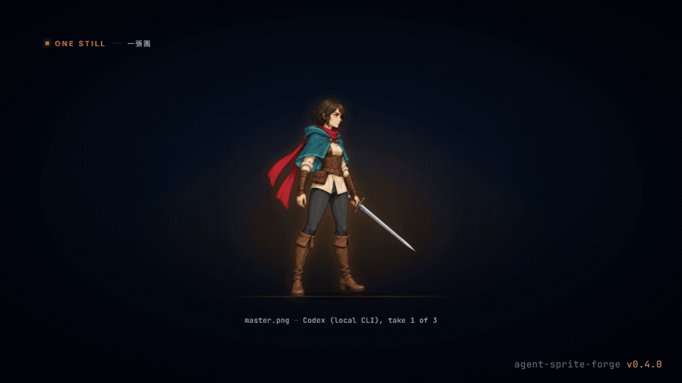
  <br />
  <em>0.4 티저: 모든 프레임이 ASF의 실제 출력입니다.</em>
</p>

> 이 페이지는 영어판과 동기화된 요약입니다. 자세한 설명은 [English README](./README.md)를 기준으로 합니다(繁體中文은 전체 번역).

## 원화 한 장 → 게임에 바로 쓰는 스프라이트 한 세트

**Claude Code**(플러그인), **Codex**, **Grok**용 에이전트 skills입니다. 에이전트가 가장 좋은 이미지 생성 경로로 원화(master still) 한 장을 만들고, 그 원화에서 액션마다 image-to-video 영상을 하나씩 생성합니다. 결정적인 Python 도구가 각 액션을 검사, 키잉, 정렬, 루프 선택, 리타임, 마무리(finish), 패키징해 Godot, Aseprite, 웹 게임으로 넘깁니다.

<p align="center">
  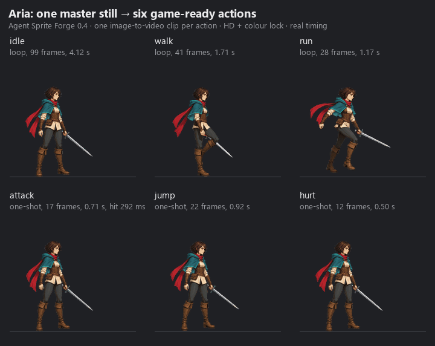
  <br />
  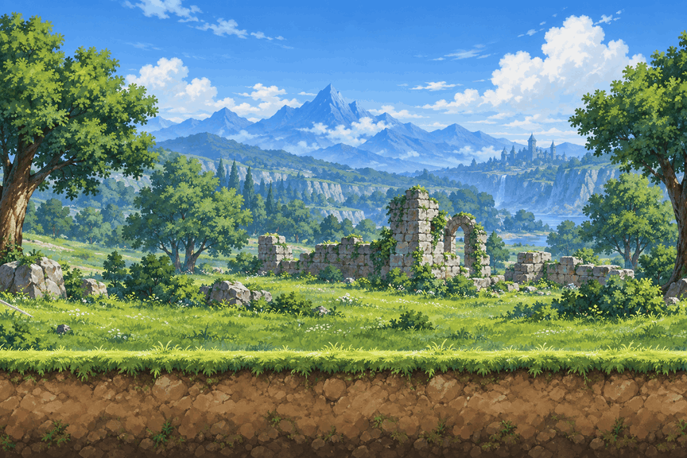
  <br />
  <em>원화 한 장(로컬 Codex CLI로 생성) → 액션마다 Grok image-to-video → 여섯 액션. 모든 프레임은 2026-10-06 실제 실행의 출력입니다.</em>
</p>

## 새 기능: pixel looks, 참고 그림을 따르는 1x 픽셀 스프라이트

<p align="center">
  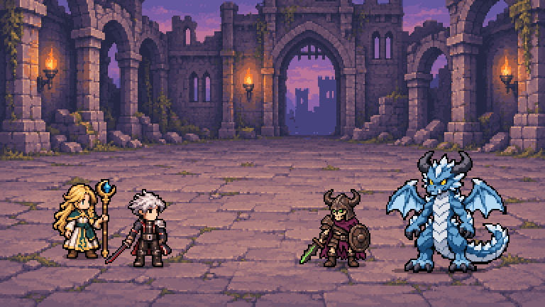
  <br />
  <em>이 전투의 캐릭터와 동작은 pixel looks 출력입니다(1x로 렌더링, 2배 표시): 1x 캐릭터 4개(마스터는 33x55~87x86), image-to-video에서 다시 읽어 온 14세트·168장의 동작. 뒤의 배경은 생성한 그림을 384x216, 40색으로 줄인 것입니다. 흰색 피격 플래시와 스켈레톤 나이트의 페이드는 데모가 넣은 연출입니다.</em>
</p>

이미지 모델에 "픽셀 아트"를 요청하면 "픽셀처럼 보이는 그림"이 나옵니다. 블록 크기가 제각각이고(이 그림에서는 15~30 px), 작은 캐릭터 하나에 88,410색이 들어 있으며, 가장자리는 흐립니다. 스프라이트 크기로 그대로 줄여도 1,033색이 남습니다. hibit은 애초에 픽셀 아트를 요청하지 않습니다. **pixel looks**는 그 반대로, "마음에 드는 룩을 따르는" 클래식한 작은 스프라이트를 위한 경로입니다. 룩은 말로 설명하지 않고, 마음에 드는 스프라이트 한 장을 캐스트 전체의 참고로 삼아, 모델이 그린 그림을 진짜 그리드로 다시 읽어 냅니다: 그림 자체의 그리드를 찾고, 블록마다 평평한 한 가지 색을 취하고, 캐릭터의 비율을 유지하고, 색을 팔레트로 줄이고, 규칙으로 외곽선을 닫습니다. 결과는 셀 수 있습니다: 33x55 픽셀, 48색, 알파는 0 또는 255뿐.

<p align="center">
  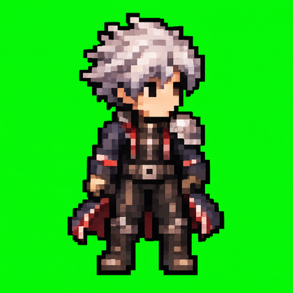
  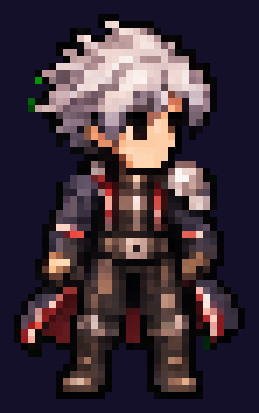
  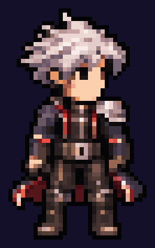
  <br />
  <em>왼쪽: 모델이 그린 그림(1254x1254, 캐릭터만 88,410색). 가운데: 그대로 33x55로 축소(1,033색). 오른쪽: <code>pixel_look.py master</code>(33x55, 48색, 반투명 픽셀 없음).</em>
</p>

- **`pixel_look.py`**(generate2dsprite): `ask-master` / `master`로 1x 마스터 스프라이트를 만들고, `ask-cast` / `cast`로 다른 캐릭터를 마스터 옆에 그리게 해 픽셀 크기와 키를 맞추고, `ask-pose` / `pose`와 `ask-view` / `view`로 마스터에서 포즈와 옆·뒤 모습을 만들고, `lineup`으로 키를 확인합니다.
- **`pixel_motion.py`**(video2dsprite): `prepare`, `frames`, `finish`, `measure`, `breath`. image-to-video의 모든 프레임을 스프라이트의 그리드와 팔레트로 다시 읽어(공격: 145프레임에서 21장) nearest 샘플링의 `animation.json` 3.0으로 내보냅니다.
- **요청할 때만 실행됩니다.** 나머지는 그대로입니다: HD, 픽셀, hibit finish와 기본값은 바뀌지 않았습니다. 참고 그림은 룩만 정하며, 캐릭터는 자신의 것을 사용하세요. 자세한 내용은 [English README](./README.md#new-pixel-looks-1x-sprites-that-follow-a-reference)와 [references/pixel-looks.md](./skills/generate2dsprite/references/pixel-looks.md).

## 새 기능: hibit, 플랫한 AI 그림을 진짜 픽셀 아트로

<p align="center">
  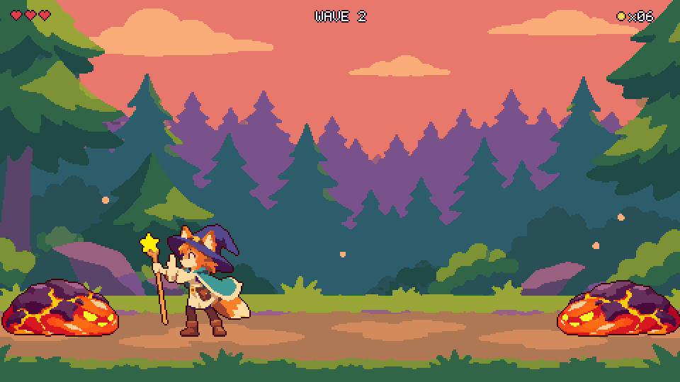
  <br />
  <em>Pip's Star Grove: hibit 결과물만으로 만든 한 화면 데모. 오토파일럿 실제 플레이(네이티브 480x270, 2배 표시). 이펙트: Patch의 <a href="https://github.com/patch-gg/pixelfx">pixelfx</a>(MIT).</em>
</p>

이미지 모델에게 "픽셀 아트"를 그리게 하지 마세요. **hibit** 스타일은 모델에게 깔끔한 플랫·무선 그림을 그리게 하고, 픽셀은 후처리에서 만듭니다. 캐릭터마다 원본 픽셀에서 학습한 팔레트 하나, 8x8 다수결 축소(색을 섞지 않음), 깜빡임을 줄이는 히스테리시스, 눈을 남기는 정리, 이진 알파, 그리고 캐릭터 자체의 색에서 가져오는 1 px 외곽선(`--outline auto`, 고정 주황색은 쓰지 않음).

<p align="center">
  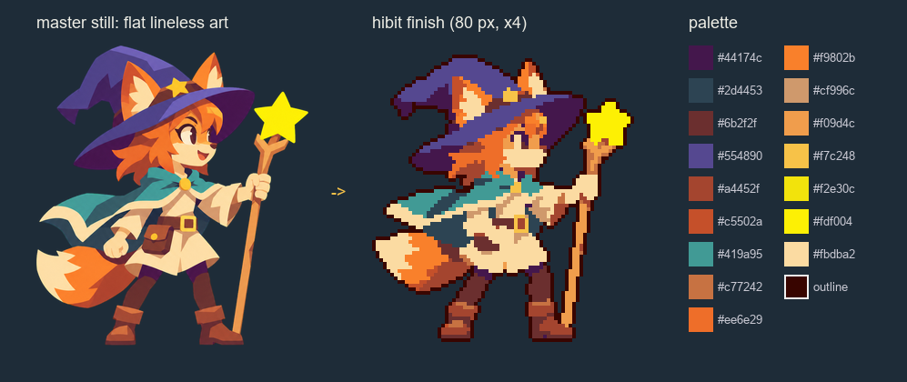
  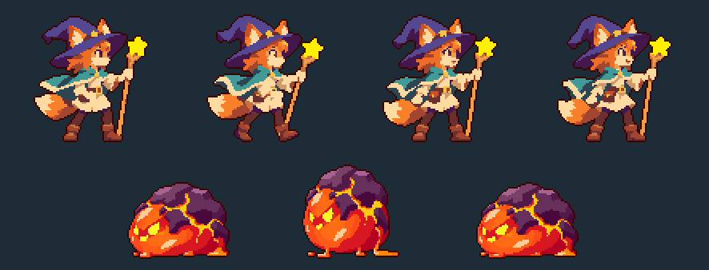
</p>

- **`master_still.py --finish hibit`**: 플랫·무선 원화. **`finish_frames.py hibit`** / **`sprite_set.py plan --finish hibit`**: 팔레트, 다수결 축소, 히스테리시스, 외곽선(80 px, 12 fps). **`hibit_plate.py`**: 480x270 배경, 14색, 셰이드 맵 포함.
- **이펙트는 두 경로**(`fx_pixelfx.py check`가 선택, 지정하면 그쪽 우선): **A: Patch의 [pixelfx](https://github.com/patch-gg/pixelfx) 추천**(독립 MIT 프로젝트, 직접 `git clone`, Node 18+ 필요; 이펙트당 16-91 프레임, 무료, `render`는 `CREDITS.txt` 포함). **B: 이미지 생성 경로**(2x2 이펙트 시트 → `process --scale-strategy registered` → `hibit_fx.py pixelize`, 이펙트당 4 프레임, 게임과 같은 화풍과 배색).

<p align="center">
  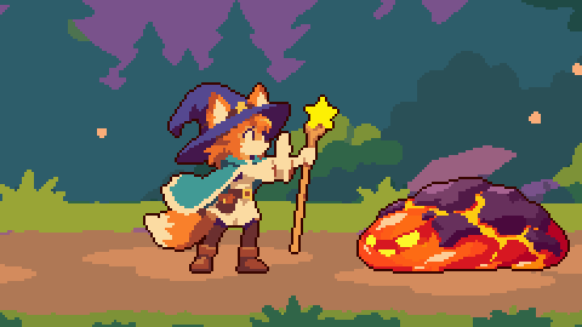
  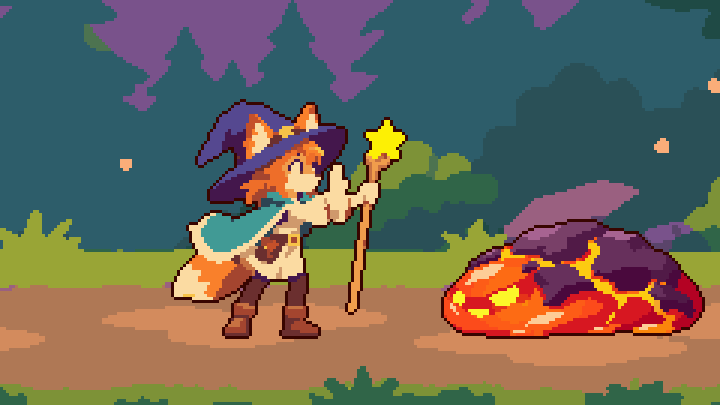
  <br />
  <em>왼쪽: A(pixelfx), 오른쪽: B(이미지 생성). 50초 전체 플레이: <a href="./src/hibit/pip-star-grove-pixelfx.mp4">pixelfx 버전 MP4</a> · <a href="./src/hibit/pip-star-grove-imagegen.mp4">이미지 생성 버전 MP4</a>. 자세한 내용은 <a href="./README.md#new-hibit-real-pixel-art-from-flat-ai-art">English README</a>.</em>
</p>

## 0.4 새 기능: 대규모 업그레이드

| 실제 실행에서 측정 | 이전 | 0.4 |
|---|---:|---:|
| 픽셀 여우(48x64, 8프레임): 프레임당 색 수 | 594–709 | **16–19** |
| 픽셀 여우: 알파 단계 / 프레임당 고립 픽셀(평균) | 199 / 732 | **2 / 75** |
| 키잉: 보라색 테두리(외곽 색 번짐, 평균) | 0.704 | **0** |
| 키잉: 145프레임에서 새어 나온 키 픽셀 / 처리 시간 | 7,780 / 271초 | **0 / 44초** |
| 공격: 원샷 길이 | 4.1초 | **0.7초** |
| 컬러 락: 인접 프레임 사이 색상 반전(달리기 루프) | 352 | **170** |
| QC: 잘못 탈락한 좋은 테이크 | 24개 중 18개 | **24개 중 0개** |

- **이미지 생성 우선:** 모든 이미지와 영상은 `route_media.py`를 거칩니다. 설정된 API 키(OpenAI, Google Gemini, xAI, BytePlus, fal.ai) → 로그인된 로컬 Codex / Grok CLI → 마지막 수단으로 코드 아트(codeart2d).
- **원화 한 장:** `master_still.py`가 후보를 생성하고 편집으로 고친 뒤 `master.json`으로 승인합니다.
- **액션 한 세트:** `sprite_set.py`가 액션마다 영상을 생성하고 자동 QC와 리테이크, 소프트 매트(보라색 테두리 없음), 정렬, 루프 자동 선택, 원샷 자동 리타임, HD 컬러 락, 기본 HD 마무리(요청 시 선명한 픽셀 마무리), 엔진 내보내기까지 처리합니다.
- **엔진 내보내기:** animation.json 3.0, PNG 아틀라스, WebM alpha, packed MP4, Godot SpriteFrames / Sprite3D, Aseprite JSON. 맵은 Tiled, Godot, LDtk.

전후 비교 이미지와 자세한 설명: [What's new](./README.md#whats-new-in-04--the-big-upgrade), [CHANGELOG](./CHANGELOG.md), [실행 기록](./docs/validation-2026-10-06.md).

## 빠른 시작

1. **설치.** Claude Code:

   ```bash
   claude plugin marketplace add 0x0funky/agent-sprite-forge --sparse .claude-plugin skills
   claude plugin install agent-sprite-forge@agent-sprite-forge
   python -m pip install "numpy>=1.26" "Pillow>=10.1" "scipy>=1.11"
   ```

   Codex / Grok: `git clone https://github.com/0x0funky/agent-sprite-forge.git`, `python -m pip install -r requirements.txt`, 이어서 `python tools/install_skills.py --apply --host codex`(Grok은 `--host grok`). 영상에는 ffmpeg 5.1+가 필요합니다.
2. **원화:** `Use $generate2dsprite to make a master still of <당신의 캐릭터>, side view, facing right, HD.`
3. **액션 한 세트:** `Use $video2dsprite to animate the approved master: idle, walk, run, attack, jump and hurt.`

## 생성 경로와 API 키

| 순서 | 경로 | 사용 시점 |
|---|---|---|
| 1 | API: 설정된 키(OpenAI, Gemini, xAI, BytePlus, fal.ai: Kling v3, Veo 3.1, Luma, MiniMax, Wan, Vidu, LTX) | 키 설정이 곧 동의이므로 매번 묻지 않습니다 |
| 2 | 로컬 CLI: 로그인된 Codex(`image_gen`) 또는 Grok(이미지, ACP 모드 영상) | 키가 없거나 계정 사유로 API가 거부했을 때. 구독 할당량 사용 |
| 3 | 코드 아트(codeart2d) | 마지막 수단: 경로가 전혀 없거나 명시적으로 요청했을 때 |

키는 환경 변수(`OPENAI_API_KEY`, `GEMINI_API_KEY`, `XAI_API_KEY`, `ARK_API_KEY`, `FAL_KEY`) 또는 사용자 설정 파일(Windows: `%APPDATA%\agent-sprite-forge\config.json`, macOS／Linux: `~/.config/agent-sprite-forge/config.json`)에 둡니다. 자세한 내용은 [Routes and providers](./README.md#routes-and-providers).

## 링크

- [파이프라인과 엔진 내보내기](./README.md#pipeline-master--set--finish--export), [맵](./README.md#maps), [Showcase](./README.md#showcase-games-made-with-agent-sprite-forge), [도구](./README.md#tools), [요구 사항](./README.md#requirements)
- 엔진／에디터 가져오기는 아직 검증되지 않음: [Engine exports](./README.md#engine-exports) 참고
- [알려진 제한](./docs/known-limitations.md), [생성 에셋 라이선스](./README.md#generated-assets-and-licensing)

## 서드파티 크레딧

선택 사항인 픽셀 이펙트 경로(`fx_pixelfx.py`, hibit 스타일용)는 Patch가 만든 [pixelfx](https://github.com/patch-gg/pixelfx)를 실행합니다. pixelfx는 MIT 라이선스의 독립 프로젝트로, 직접 clone해서 사용하며 이 저장소에는 포함되어 있지 않습니다. pixelfx는 Hugo Duprez의 Sprite Fusion 픽셀 아트 VFX(MIT)와 rehan-remade의 Hollow Crown(MIT)에도 크레딧을 표기합니다. render할 때마다 pixelfx의 라이선스와 고지를 담은 `CREDITS.txt`가 생성되므로 프레임과 함께 보관하고, 게임에 pixelfx 크레딧을 표기하세요. 자세한 내용은 [THIRD_PARTY_NOTICES.md](./THIRD_PARTY_NOTICES.md).

## 라이선스

MIT. [LICENSE](./LICENSE) 참고.
