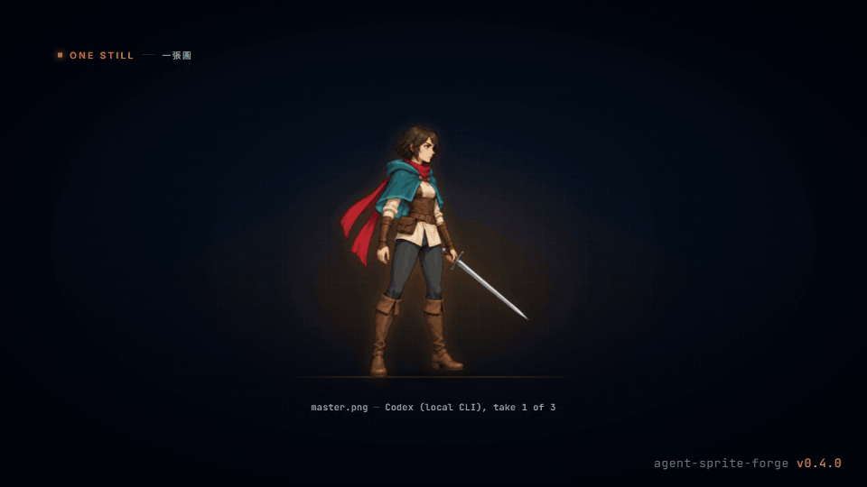
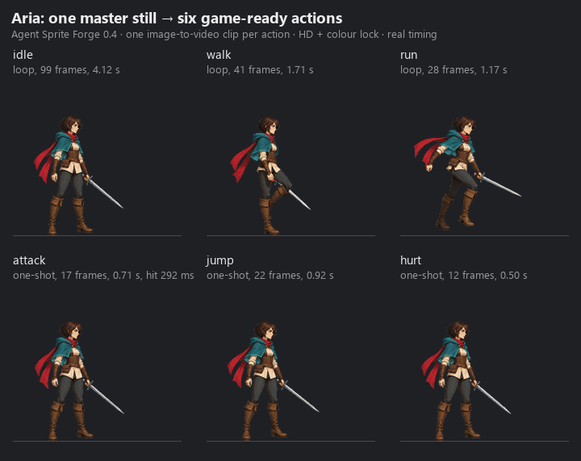
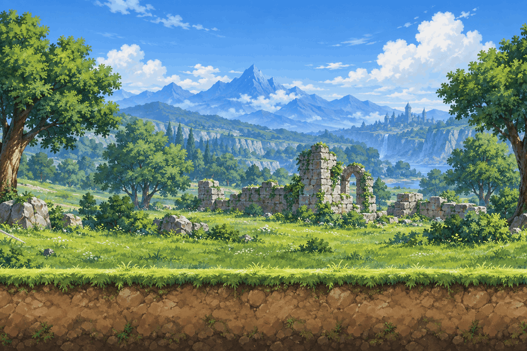
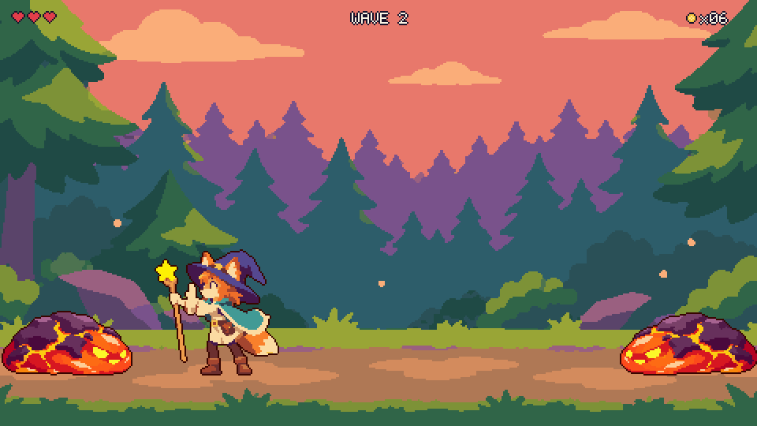
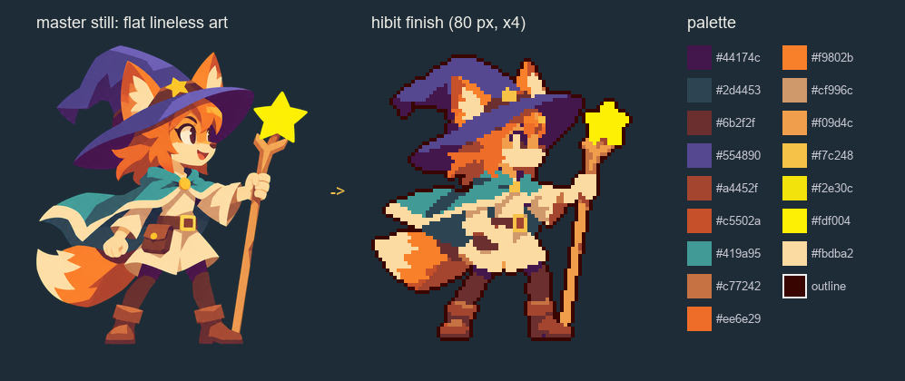
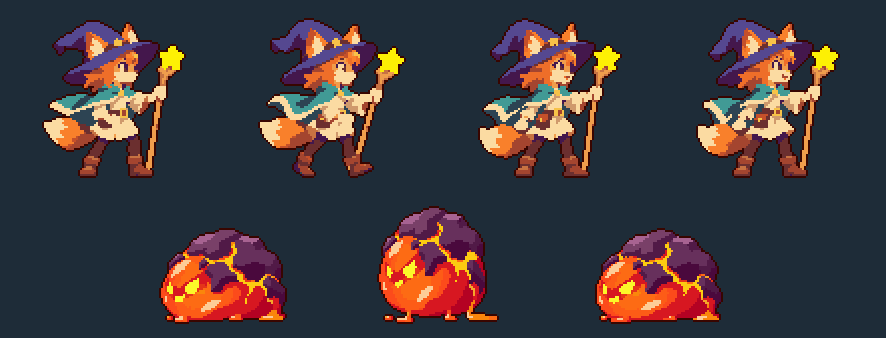
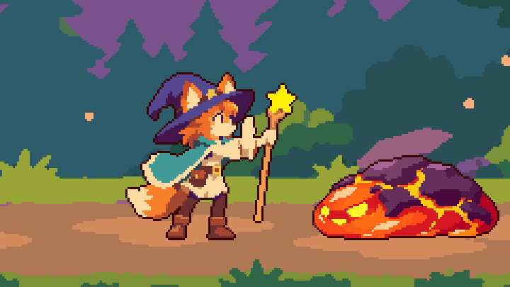
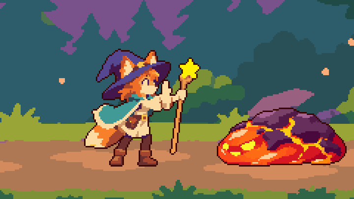

# Agent Sprite Forge

语言：[English](./README.md) | [繁體中文](./README.zh-TW.md) | [简体中文](./README.zh-CN.md) | [日本語](./README.ja.md) | [한국어](./README.ko.md)

<p align="center">
  
</p>

<p align="center">
  <a href="https://trendshift.io/repositories/42911?utm_source=repository-badge&amp;utm_medium=badge&amp;utm_campaign=badge-repository-42911" target="_blank" rel="noopener noreferrer"></a>
</p>

<p align="center">
  
  <br />
  <em>0.4 宣传预告：每一帧都是 ASF 的真实输出。</em>
</p>

> 本页是与英文版同步的摘要。完整说明以 [English README](./README.md) 为准（繁體中文为完整翻译）。

## 一张原画 → 整套可进游戏的 sprite

面向 **Claude Code**（插件）、**Codex** 与 **Grok** 的 agent 技能。Agent 用你手上最好的生图路径做出一张原画（master still），再从这张原画为每个动作各生成一段图生视频（image-to-video），然后由确定性的 Python 工具逐一把关、抠图、对位、挑循环、重新计时、后期处理（finish）并打包，交给 Godot、Aseprite 或网页游戏。

<p align="center">
  
  <br />
  
  <br />
  <em>一张原画（本机 Codex CLI 生成）→ 每个动作一段 Grok 图生视频 → 六个动作。每一帧都来自 2026-10-06 的实机运行。</em>
</p>

## 新功能：hibit，把平涂 AI 图变成真正的像素画

<p align="center">
  
  <br />
  <em>Pip's Star Grove：完全用 hibit 产出做的单画面小游戏，自动驾驶实机游玩（原生 480x270，2 倍显示）。特效：Patch 制作的 <a href="https://github.com/patch-gg/pixelfx">pixelfx</a>（MIT）。</em>
</p>

不要让图像模型画“像素画”。**hibit** 风格让模型画干净的平涂无线稿图，像素在后期才产生：每个角色从原始像素学一套调色板，8x8 多数决缩图（绝不混色），迟滞（hysteresis）压闪烁，保留眼睛，二值 alpha，再加一圈颜色取自角色本身的 1 px 描边（`--outline auto`，不会固定用橙色）。

<p align="center">
  
  
</p>

- **`master_still.py --finish hibit`**：平涂无线稿原画。**`finish_frames.py hibit`** / **`sprite_set.py plan --finish hibit`**：调色板、多数决缩图、迟滞与描边（80 px、12 fps）。**`hibit_plate.py`**：480x270 背景，14 色，附 shade map。
- **特效两条路径**（`fx_pixelfx.py check` 自动选择，你指定的优先）：**A：推荐 Patch 制作的 [pixelfx](https://github.com/patch-gg/pixelfx)**（独立 MIT 项目，请自行 `git clone`，需要 Node 18+；每个特效 16-91 帧、免费，`render` 附 `CREDITS.txt`）；**B：生图路径**（2x2 特效 sheet → `process --scale-strategy registered` → `hibit_fx.py pixelize`，每个特效 4 帧，风格与配色和游戏一致）。

<p align="center">
  
  
  <br />
  <em>左：A（pixelfx）；右：B（生图）。完整 50 秒游玩：<a href="./src/hibit/pip-star-grove-pixelfx.mp4">pixelfx 版 MP4</a> · <a href="./src/hibit/pip-star-grove-imagegen.mp4">生图版 MP4</a>。详见 <a href="./README.md#new-hibit-real-pixel-art-from-flat-ai-art">English README</a>。</em>
</p>

## 0.4 新功能：大升级

| 实机测量 | 升级前 | 0.4 |
|---|---:|---:|
| 像素狐狸（48x64，8 帧）：每帧颜色数 | 594–709 | **16–19** |
| 像素狐狸：alpha 阶数 / 每帧孤立像素（平均） | 199 / 732 | **2 / 75** |
| 抠图：紫边（外圈溢色，平均） | 0.704 | **0** |
| 抠图：145 帧中漏出的 key 像素 / 用时 | 7,780 / 271 秒 | **0 / 44 秒** |
| 攻击：单次动作长度 | 4.1 秒 | **0.7 秒** |
| 颜色锁定：每对相邻帧的色相翻转（跑步循环） | 352 | **170** |
| QC：被误判淘汰的好 take | 24 段中 18 段 | **24 段中 0 段** |

- **生图优先：** 所有图片和视频都经过 `route_media.py`：已配置的 API key（OpenAI、Google Gemini、xAI、BytePlus、fal.ai）→ 你已登录的本机 Codex / Grok CLI → 最后才是代码绘制（codeart2d）。
- **一张原画：** `master_still.py` 生成候选、用编辑修正、核准为 `master.json`。
- **整套动作：** `sprite_set.py` 为每个动作生成一段视频，自动 QC 与重拍、soft matte 抠图（无紫边）、对位、自动挑循环、单次动作自动重新计时、HD 颜色锁定，默认 HD 后期，可选清晰的像素后期，并导出引擎文件。
- **引擎导出：** animation.json 3.0、PNG atlas、WebM alpha、packed MP4；Godot SpriteFrames / Sprite3D；Aseprite JSON；地图导出 Tiled、Godot、LDtk。

前后对比图与完整说明：[What's new](./README.md#whats-new-in-04--the-big-upgrade)、[CHANGELOG](./CHANGELOG.md)、[实机记录](./docs/validation-2026-10-06.md)。

## 快速开始

1. **安装。** Claude Code：

   ```bash
   claude plugin marketplace add 0x0funky/agent-sprite-forge --sparse .claude-plugin skills
   claude plugin install agent-sprite-forge@agent-sprite-forge
   python -m pip install "numpy>=1.26" "Pillow>=10.1" "scipy>=1.11"
   ```

   Codex / Grok：`git clone https://github.com/0x0funky/agent-sprite-forge.git`，`python -m pip install -r requirements.txt`，然后 `python tools/install_skills.py --apply --host codex`（Grok 用 `--host grok`）。视频需要 ffmpeg 5.1+。
2. **原画：** `Use $generate2dsprite to make a master still of <你的角色>, side view, facing right, HD.`
3. **整套动作：** `Use $video2dsprite to animate the approved master: idle, walk, run, attack, jump and hurt.`

## 生成路径与 API key

| 顺序 | 路径 | 何时使用 |
|---|---|---|
| 1 | API：已配置的 key（OpenAI、Gemini、xAI、BytePlus、fal.ai：Kling v3、Veo 3.1、Luma、MiniMax、Wan、Vidu、LTX） | 配置了 key 即视为同意，不再逐次询问 |
| 2 | 本机 CLI：你已登录的 Codex（`image_gen`）或 Grok（图片、ACP 模式视频） | 没有 key 或 API 因账号原因拒绝时；使用订阅额度 |
| 3 | 代码绘制（codeart2d） | 最后手段：没有任何路径或你明确要求时 |

Key 放在环境变量（`OPENAI_API_KEY`、`GEMINI_API_KEY`、`XAI_API_KEY`、`ARK_API_KEY`、`FAL_KEY`）或用户配置文件（Windows：`%APPDATA%\agent-sprite-forge\config.json`；macOS／Linux：`~/.config/agent-sprite-forge/config.json`）。详见 [Routes and providers](./README.md#routes-and-providers)。

## 链接

- [流程与引擎导出](./README.md#pipeline-master--set--finish--export)、[地图](./README.md#maps)、[Showcase](./README.md#showcase-games-made-with-agent-sprite-forge)、[工具](./README.md#tools)、[需求](./README.md#requirements)
- 引擎／编辑器导入尚未验证：见 [Engine exports](./README.md#engine-exports)
- [已知限制](./docs/known-limitations.md)、[生成素材的授权说明](./README.md#generated-assets-and-licensing)

## 第三方致谢

可选的像素特效路径（`fx_pixelfx.py`，搭配 hibit 风格）调用 Patch 制作的 [pixelfx](https://github.com/patch-gg/pixelfx)：独立的 MIT 授权项目，需自行 clone，本仓库并未内置。pixelfx 另外致谢 Hugo Duprez 的 Sprite Fusion 像素特效（MIT）与 rehan-remade 的 Hollow Crown（MIT）。每次 render 都会写出附 pixelfx 授权与声明的 `CREDITS.txt`，请随 frames 一起保留，并在游戏中注明 pixelfx。详见 [THIRD_PARTY_NOTICES.md](./THIRD_PARTY_NOTICES.md)。

## 授权

MIT，见 [LICENSE](./LICENSE)。
